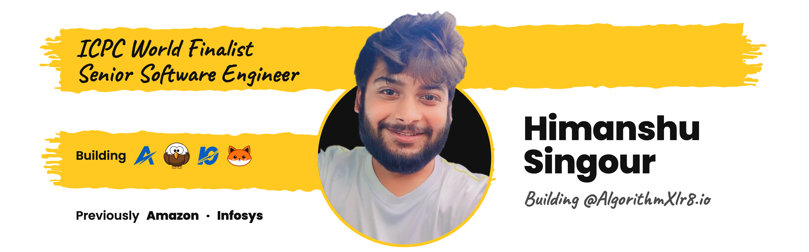

<a href="https://portfolio.algorithmxlr8.io">
  <picture>
    <source media="(prefers-color-scheme: dark)" srcset="assets/banner-dark-v3.png">
    
  </picture>
</a>

## Hey there 👋

I'm **Himanshu Singour**, an **ICPC World Finalist** and full stack and AI engineer with 4+ years in fintech and payments. I build products that help engineers prepare for interviews, practise with an AI interviewer and track their growth.

- **Currently:** Building [AlgorithmXlr8.io](https://algorithmxlr8.io), [InterviewXlr8.io](https://interviewxlr8.io), [CodEyes.in](https://codeyes.in) and [Roadmaps.io](https://roadmap.algorithmxlr8.io), along with AI workflows, RAG pipelines and real time voice AI.
- **Previously:** Senior Software Developer at Rahi Platform Technologies · Specialist Programmer at Infosys · SDE at Amazon (Amazon Shipment) · DSA Expert at Chegg

## What I'm building

<table>
  <tr>
    <td width="72" align="center"></td>
    <td><a href="https://algorithmxlr8.io"><b>AlgorithmXlr8.io</b></a> Interview prep platform with four tracks: Software, AI, DevOps and Blockchain Engineer. DSA, LLD, HLD and CS core in one structured path, on the web and on iOS and Android.</td>
  </tr>
  <tr>
    <td align="center"></td>
    <td><a href="https://interviewxlr8.io"><b>InterviewXlr8.io</b></a> AI mock interviews by voice for DSA, system design, SQL, machine coding and debugging rounds.</td>
  </tr>
  <tr>
    <td align="center"></td>
    <td><a href="https://codeyes.in"><b>CodEyes.in</b></a> One coding profile for LeetCode, Codeforces, CodeChef, GitHub, Medium and Substack, with contest reminders, leaderboards and 1v1 duels.</td>
  </tr>
  <tr>
    <td align="center"></td>
    <td><a href="https://roadmap.algorithmxlr8.io"><b>Roadmaps.io</b></a> Step by step developer roadmaps for roles and skills, with progress tracking on every topic.</td>
  </tr>
</table>

## Tech I work with

<picture>
  <source media="(prefers-color-scheme: dark)" srcset="https://skillicons.dev/icons?i=ts%2Cjs%2Cjava%2Ccpp%2Cpython%2Cnodejs%2Cexpress%2Creact%2Cnextjs%2Cangular%2Ctailwind%2Cvite%2Cspring&theme=dark&perline=13">
  
</picture>
 
<picture>
  <source media="(prefers-color-scheme: dark)" srcset="https://skillicons.dev/icons?i=mongodb%2Cmysql%2Csupabase%2Ckafka%2Cdocker%2Ckubernetes%2Caws%2Ccloudflare%2Cgithubactions%2Cjenkins%2Cprometheus%2Cgrafana%2Clinux&theme=dark&perline=13">
  
</picture>

**AI:** Gemini and Gemini Live · RAG pipelines · AI agents · LLM workflows 
**Mobile:** React Native with Expo, shipped on the App Store and Google Play

## Popular repositories

| Repository | What's inside | |
|---|---|---|
| [Practice-Problem-LLD](https://github.com/HimanshuSingour/Practice-Problem-LLD) | 33 low level design practice problems: parking lot, elevator, ATM, chess, food delivery and more |  |
| [Important-DSA-Topic-Problems](https://github.com/HimanshuSingour/Important-DSA-Topic-Problems) | Must do DSA problems grouped by topic, from greedy to divide and conquer |  |
| [Bank-Of-Bharat-BOB](https://github.com/HimanshuSingour/Bank-Of-Bharat-BOB) | Core banking backend in Java and Spring Boot that other apps call for payments |  |
| [UPI-Payment-Application](https://github.com/HimanshuSingour/UPI-Payment-Application) | UPI style bill payments, recharges and flight booking, settled through Bank of Bharat |  |
| [Flight-Booking-Application-](https://github.com/HimanshuSingour/Flight-Booking-Application-) | Domestic and international flight booking system in Spring Boot |  |
| [Google-Pay-Payment-Application-](https://github.com/HimanshuSingour/Google-Pay-Payment-Application-) | Google Pay style payments backend with auth and transaction handling |  |

## Latest writing

**Newsletter** on [singour.substack.com](https://singour.substack.com)
- [Learn to Build AI Agents, End to End](https://singour.substack.com/p/learn-to-build-ai-agents-end-to-end)
- [How to Become a Great AI Engineer](https://singour.substack.com/p/how-to-become-a-great-ai-engineer)
- [Is DSA Still Needed in the AI Era?](https://singour.substack.com/p/is-dsa-still-needed-in-the-ai-era)
- [Software Engineering Is Dead.](https://singour.substack.com/p/software-engineering-is-dead)

**Medium** at [@himanshusingour7](https://medium.com/@himanshusingour7)
- [I Built My First RAG System Because My Dad Asked One Simple Question](https://medium.com/@himanshusingour7/i-built-my-first-rag-system-because-my-dad-asked-one-simple-question-16c6e3e115cd)
- [JWT in Microservices: What Really Happens from API Gateway to 10 Microservices](https://medium.com/@himanshusingour7/jwt-in-microservices-what-really-happens-from-api-gateway-to-10-microservices-392ed6d78fd3)
- [Every Frontend Architecture Pattern](https://medium.com/@himanshusingour7/every-frontend-architecture-pattern-340d16d9e049)

## Highlights

- **ICPC World Finalist**
- **Two Rise Awards** at Infosys as a Specialist Programmer in fintech
- **Best Placement Award**, 2022
- Teaching **223K+** engineers on Instagram and **53K+** on LinkedIn

## Let's connect

